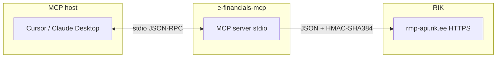

# e-financials-mcp

Open-source MCP server for **e-arveldaja** (the online accounting software of RIK, the Estonian Centre of Registers and Information Systems), known in English as **e-Financials**. It wraps the [RIK e-Financials REST API](https://abiinfo.rik.ee/en/e-financials/e-financials-api/technical-documentation-developers) and exposes accounting operations (bank transactions, clients, invoices, chart of accounts, journals, products, reports) as **Model Context Protocol** tools, so AI assistants (Claude, ChatGPT, Cursor, etc.) can work with your company's e-arveldaja data.

## Hosted: werkzeug.ee

No install needed. Sign up at [werkzeug.ee](https://werkzeug.ee), get your personal MCP endpoint (`https://werkzeug.ee/mcp/c/<id>`) and paste it into Claude, ChatGPT or Cursor as a remote MCP server. Client-by-client steps: [werkzeug.ee/docs](https://werkzeug.ee/docs/).

Prefer to run it yourself over **stdio**? See [Quick start](#quick-start) below.

## Tools at a glance

<!-- tools:start (generated by npm run docs:readme) -->
**100 tools.** Click a group to expand it.

<details><summary><b>Bank transactions</b> (12)</summary>

| Tool | Description |
|------|-------------|
| `list_transactions` | List bank transactions with optional filters. |
| `get_transaction` | Get a bank transaction by ID. |
| `get_unprocessed_transactions` | Get all unprocessed (PROJECT status) transactions that don't have a client assigned yet. |
| `update_transaction` | Update a PROJECT draft: clients_id, accounts_id, description, and optional type (C = money in, D = money out). type is translated to RIK's opposite letter,… |
| `create_transaction` | Create a bank transaction draft (PROJECT). type C is money in and type D is money out. |
| `pay_purchase_invoice` | Mark a CONFIRMED purchase invoice paid from a cash or bank dimension (for example account 1360, Arveldused aruandvate isikutega). |
| `delete_transaction` | Delete a transaction. |
| `register_transaction` | Register (confirm/post) a bank transaction with distribution rows. |
| `invalidate_transaction` | Invalidate a registered transaction (reverse registration per API rules). |
| `get_transaction_file` | Get the user-uploaded file attached to a bank transaction (OpenAPI ApiFile: name + base64 contents). |
| `upload_transaction_file` | Upload a file to a bank transaction (PUT .../document_user). |
| `delete_transaction_file` | Delete the user-uploaded file from a bank transaction. |

</details>

<details><summary><b>Clients</b> (9)</summary>

| Tool | Description |
|------|-------------|
| `list_clients` | List all clients (buyers and suppliers). |
| `list_suppliers` | List all suppliers (vendors you pay). |
| `get_client` | Get details of a specific client by ID |
| `search_clients` | Search for clients by name. |
| `create_client` | Create a new client (buyer or supplier). |
| `update_client` | PATCH an existing client. |
| `delete_client` | Permanently delete a client by ID. |
| `deactivate_client` | Deactivate a client (soft-disable). |
| `reactivate_client` | Reactivate a previously deactivated client. |

</details>

<details><summary><b>Invoices</b> (26)</summary>

| Tool | Description |
|------|-------------|
| `list_sales_invoices` | List sales invoices (invoices you send to customers) with optional filters. |
| `list_purchase_invoices` | List purchase invoices (invoices from suppliers you need to pay) with optional filters. |
| `list_unpaid_invoices` | List all unpaid invoices (both sales and purchase). |
| `get_sales_invoice` | Get details of a specific sales invoice by ID |
| `get_purchase_invoice` | Get details of a specific purchase invoice by ID |
| `create_sales_invoice` | Create a new sales invoice draft. |
| `validate_invoice_data` | Read-only pre-booking checks for invoice totals, line nets/VAT, calendar dates, Estonian standard VAT rate vs invoice date, and foreign-currency rate… |
| `create_purchase_invoice` | Create a purchase invoice draft (PROJECT), apply VAT defaults, then repair invoice-level vat_price/gross_price from line items (create-then-repair). |
| `update_sales_invoice` | Update a sales invoice draft. |
| `delete_sales_invoice` | Delete a sales invoice. |
| `register_sales_invoice` | Register (post to the books) a sales invoice. |
| `invalidate_sales_invoice` | Invalidate a registered sales invoice (reverse registration per API rules). |
| `get_sales_invoice_xml` | Get the system-generated e-invoice XML for a sales invoice (OpenAPI ApiFile: name + base64 contents). |
| `get_sales_invoice_pdf_system` | Get the system-generated PDF for a sales invoice (OpenAPI ApiFile: name + base64 contents). |
| `get_sales_invoice_user_file` | Get the user-uploaded file attached to a sales invoice (OpenAPI ApiFile: name + base64 contents). |
| `upload_sales_invoice_user_file` | Upload a file to a sales invoice (PUT .../document_user). |
| `delete_sales_invoice_user_file` | Delete the user-uploaded file from a sales invoice. |
| `get_sales_invoice_delivery_options` | Get delivery options for a sales invoice (e-invoice vs email, suggested addresses, reasons). |
| `deliver_sales_invoice` | Send a sales invoice to the customer (PATCH .../deliver): e-invoice and/or email with optional subject and body. |
| `update_purchase_invoice` | Update a purchase invoice draft (PROJECT). |
| `delete_purchase_invoice` | Delete a purchase invoice. |
| `register_purchase_invoice` | Register (post to the books) a purchase invoice. |
| `invalidate_purchase_invoice` | Invalidate a registered purchase invoice (reverse registration per API rules). |
| `get_purchase_invoice_user_file` | Get the user-uploaded file attached to a purchase invoice (OpenAPI ApiFile: name + base64 contents). |
| `delete_purchase_invoice_user_file` | Delete the user-uploaded file from a purchase invoice. |
| `upload_purchase_invoice_file` | Upload a PDF or other file attachment to a purchase invoice. |

</details>

<details><summary><b>Invoice settings</b> (7)</summary>

| Tool | Description |
|------|-------------|
| `get_invoice_info` | Get company invoice settings (address, templates, email templates for invoices and balance letters). |
| `update_invoice_info` | PATCH company invoice settings. |
| `list_invoice_series` | List all invoice series for the company (number prefix, terms, default flag). |
| `get_invoice_series` | Get one invoice series by ID (OpenAPI InvoiceSeries). |
| `create_invoice_series` | Create an invoice series. |
| `update_invoice_series` | PATCH an invoice series. |
| `delete_invoice_series` | Delete an invoice series by ID. |

</details>

<details><summary><b>Journals</b> (10)</summary>

| Tool | Description |
|------|-------------|
| `list_journals` | List journal entries with optional pagination and filters (modified_since, effective date range, operation_type). |
| `get_journal` | Get one journal entry by ID (includes postings). |
| `create_journal` | Create a journal entry (POST). |
| `update_journal` | PATCH an existing journal entry. |
| `delete_journal` | Delete a journal entry by ID. |
| `register_journal` | Register (confirm/post) a journal entry. |
| `invalidate_journal` | Invalidate a journal entry (reverse registration state per API rules). |
| `get_journal_file` | Get the user-uploaded file attached to a journal entry (OpenAPI ApiFile: name + base64 contents). |
| `upload_journal_file` | Upload a file to a journal entry (PUT .../document_user). |
| `delete_journal_file` | Delete the user-uploaded file from a journal entry. |

</details>

<details><summary><b>Products</b> (7)</summary>

| Tool | Description |
|------|-------------|
| `list_products` | List products/services for the company with optional pagination and modified_since filter. |
| `get_product` | Get one product/service by ID. |
| `create_product` | Create a product/service. |
| `update_product` | PATCH an existing product/service. |
| `delete_product` | Delete a product/service by ID. |
| `deactivate_product` | Deactivate a product/service. |
| `reactivate_product` | Reactivate a previously deactivated product/service. |

</details>

<details><summary><b>Accounts</b> (11)</summary>

| Tool | Description |
|------|-------------|
| `list_accounts` | List the chart of accounts. |
| `get_bank_accounts` | List all bank accounts configured in e-Financials. |
| `create_bank_account` | Create a bank account in e-Financials. |
| `get_bank_account` | Get one bank account by ID. |
| `update_bank_account` | PATCH an existing bank account. |
| `delete_bank_account` | Delete a bank account by ID. |
| `get_vat_info` | Get company VAT information (VAT number and tax reference number). |
| `list_projects` | List all projects (cost/profit centers). |
| `search_accounts` | Search for an account by name or ID. |
| `list_account_dimensions` | List account dimensions (sub-accounts). |
| `list_purchase_articles` | List purchase articles (expense categories). |

</details>

<details><summary><b>Reference data</b> (3)</summary>

| Tool | Description |
|------|-------------|
| `list_currencies` | List active currencies configured for the company (codes and Estonian/English names). |
| `list_sale_articles` | List sale articles (revenue / sales categories linked to accounts and VAT) for the company. |
| `list_templates` | List sale invoice templates available for the company. |

</details>

<details><summary><b>Reports</b> (3)</summary>

| Tool | Description |
|------|-------------|
| `reconciliation_report` | Generate a reconciliation report comparing bank transactions with invoices. |
| `match_transaction_to_supplier` | Analyze a transaction description and suggest matching suppliers from the client list. |
| `financial_summary` | Get a summary of financial data including transaction counts, invoice totals, and outstanding amounts. |

</details>

<details><summary><b>Financial statements</b> (8)</summary>

| Tool | Description |
|------|-------------|
| `compute_trial_balance` | Compute a trial balance (käibeandmik) from registered journal postings. |
| `compute_balance_sheet` | Compute a balance sheet (bilanss) as of date_to from registered journal postings (cumulative, including the opening-balance journal; do not add opening… |
| `compute_profit_and_loss` | Compute a profit and loss statement (kasumiaruanne) from registered journal postings for date_from/date_to, excluding year-end closing by default. |
| `compute_receivables_aging` | Compute receivables aging from unpaid confirmed sale invoices. |
| `compute_payables_aging` | Compute payables aging from unpaid confirmed purchase invoices. |
| `compute_account_balance` | Compute the balance of one chart account from registered journal postings (EUR base_amount when present). |
| `compute_client_debt` | Compute a client's net position from registered journal postings tagged with clients_id. |
| `month_end_close_checklist` | Surfaces everything blocking a month-end close for a YYYY-MM month. |

</details>

<details><summary><b>Bank reconciliation and import</b> (4)</summary>

| Tool | Description |
|------|-------------|
| `analyze_unconfirmed_transactions` | Read-only diagnostic for PROJECT bank transactions: suggest duplicates, inter-account transfers, invoice matches, small bank fees, or manual review. |
| `reconcile_bank_transactions` | Mode-based bank reconciliation. mode=match (default): score PROJECT txs against open invoices. mode=auto_confirm: dry-run by default; with execute=true… |
| `classify_bank_transactions` | Classify unmatched PROJECT bank transactions by counterparty (bank fees, SaaS, card purchases, tax, owner transfers, salary, revenue, unknown). |
| `process_camt053` | Import an ISO 20022 CAMT.053 bank statement (LHV, Swedbank, SEB, Coop, Luminor). |

</details>
<!-- tools:end -->

Details, required arguments and caveats per tool: [MCP tools reference](#mcp-tools-reference).

## Quick start

```bash
git clone https://github.com/werkstatt-jasper/e-financials-mcp.git
cd e-financials-mcp
cp .env.example .env
# Fill in your RIK API credentials in .env
npm install
npm run build
npm start
```

## Prerequisites

- **Node.js 20+** (see `package.json` `engines`; native `fetch`; Vitest 4 / CI require Node 20+).
- An **e-Financials API key** for your company.

### API keys

A board member (or authorized user) can create keys in e-Financials:

**Settings > General settings > e-Financials API access permits**

Each key requires a name, allowed IP addresses, and at least one permitted function.

## Environment variables

Copy `.env.example` to `.env` and fill in your credentials. The server loads `.env` automatically via `dotenv/config` at startup. **Never commit `.env`** (it is gitignored).

| Variable | Required | Description |
|----------|----------|-------------|
| `RIK_API_KEY_ID` | Yes | API key identifier (used in the HMAC signing string). |
| `RIK_API_KEY_PASSWORD` | Yes | Secret used as the HMAC key. |
| `RIK_API_KEY_PUBLIC` | Yes | Public part of `X-AUTH-KEY` (from e-Financials). |
| `RIK_API_BASE_URL` | No | Base URL without trailing slash. Default: `https://rmp-api.rik.ee`. Set to `https://demo-rmp-api.rik.ee` for the demo environment. |
| `RIK_HTTP_MAX_RETRIES` | No | Extra HTTP attempts for transient failures (network errors, 408, 429, 5xx). Default: `0`. |
| `RIK_HTTP_RETRY_BASE_MS` | No | Base delay in ms for exponential backoff. Default: `500`. |
| `RIK_REQUEST_TIMEOUT_MS` | No | Maximum time in ms per outbound request. Default: `30000`. |
| `LOG_LEVEL` | No | Pino log level on **stderr**: `fatal`, `error`, `warn`, `info`, `debug`, `trace`, `silent`. Default: `info`. |

## MCP host configuration

Point your MCP client at the built server.

**Cursor** (`~/.cursor/mcp.json` or project `.cursor/mcp.json`):

```json
{
  "mcpServers": {
    "e-financials": {
      "command": "node",
      "args": ["/absolute/path/to/e-financials-mcp/dist/index.js"],
      "env": {
        "RIK_API_KEY_ID": "your_api_key_id",
        "RIK_API_KEY_PASSWORD": "your_api_key_password",
        "RIK_API_KEY_PUBLIC": "your_base64_public_key"
      }
    }
  }
}
```

**Claude Desktop** — same pattern under `mcpServers` in the app's config file, adjusting paths for your OS.

Alternatively, if your `.env` file is populated and the working directory is the project root, `npm start` picks up credentials automatically.

## Architecture



## Authentication (how requests are signed)

1. **`X-AUTH-QUERYTIME`** — UTC timestamp, one-second precision, no milliseconds.
2. **`X-AUTH-KEY`** — `{RIK_API_KEY_PUBLIC}:{signature}` where `signature` is **Base64(HMAC-SHA-384)** over `{RIK_API_KEY_ID}:{X-AUTH-QUERYTIME}:{urlPath}`.
3. `urlPath` is the **path only** (e.g. `/v1/transactions`), no query string.
4. **`User-Agent: e-financials-mcp/1.0 (+https://github.com/werkstatt-jasper/e-financials-mcp)`** — descriptive UA instead of Node's generic `node` default.
5. Requests use a plain **`node:https`** transport ([`src/rik-http.ts`](src/rik-http.ts)), not global `fetch`: undici fetch's non-removable `Sec-Fetch-Mode: cors` header makes Cloudflare (in front of the production API) 403-challenge requests from datacenter IPs. Cloudflare-served error responses are logged with their `cf-ray` ID.

## MCP surface

The server advertises **tools**, **prompts**, and **resources** over stdio.

### Tools

The server advertises the tools listed in [Tools at a glance](#tools-at-a-glance) across transactions, clients, invoices, invoice settings, products, journals, accounts, reference data, and reports. All tool results are JSON in text content blocks.

### Prompts

| Prompt | Description |
|--------|-------------|
| `getting-started` | Introduces the tool surface, `efinancials://` resources, and safe-usage conventions. Optional `focus` argument to emphasize a topic. |

### Resources

Static and templated resources use the **`efinancials://`** URI scheme.

| URI | Description |
|-----|-------------|
| `efinancials://server_info` | Server name, version, and capability summary (JSON; no API call). |

## MCP tools reference

### Transactions

RIK's GET returns `type: "C"` for every transaction, whichever direction it was saved with. The tools read the stored direction from that day's lists. A row in the `type` filter (it ignores the letter and returns only incoming rows) is money in. A row that is only in the unfiltered list is money out. A row in neither list, or one with no valid date, has an unknown direction: reads return `type: null`, and a create is kept with `direction_confirmed: false`.

| Tool | Description |
|------|-------------|
| `list_transactions` | List bank transactions with filters (status, dates, type, client, page). `type` is `C` money in, `D` money out, read from the stored direction. |
| `get_transaction` | Single transaction by ID (may include read-only `items[]` relation rows). `type` is the stored direction (`C` money in, `D` money out), or null when it is unknown (`direction_confirmed: false`). |
| `get_unprocessed_transactions` | `PROJECT` transactions with no client. |
| `update_transaction` | PATCH draft metadata (`clients_id`, `accounts_id`, `description`) and optional direction (`type`), which is checked against the stored direction. Unknown direction leaves the update in place with `direction_confirmed` false. Not distribution rows. |
| `create_transaction` | POST new draft (`PROJECT`). `C` is money in and `D` is money out; the RIK letter is translated and the stored direction is checked. Unknown direction keeps the draft with `direction_confirmed` false. |
| `pay_purchase_invoice` | Pay a CONFIRMED purchase invoice from a cash or bank dimension (outgoing type `D`) and register it. Refuses a likely duplicate unless `allow_duplicate`; an unconfirmed save is kept as an unregistered draft. |
| `delete_transaction` | DELETE transaction. |
| `register_transaction` | Confirm with full `distributions[]` (`accounts` / `purchase_invoices` / `sale_invoices`). UI equivalent of Add a row + Save and confirm. |
| `invalidate_transaction` | Reverse registration. |
| `get_transaction_file` | GET attached file. |
| `upload_transaction_file` | Upload file from local path, `https://` URL, or `base64:<data>` / `base64:<ext>:<data>` (max 10 MiB). Optional `filename` overrides Content-Disposition / URL path. |
| `delete_transaction_file` | DELETE attached file. |

### Clients

| Tool | Description |
|------|-------------|
| `list_clients` | Paginated client list. |
| `list_suppliers` | Clients with `is_supplier: true`. |
| `get_client` | One client by ID. |
| `search_clients` | Search over all pages (name, reg code, email). |
| `create_client` | Create a new client. Estonian private clients need `is_physical_entity: true` (empty `reg_code` alone is not enough). |
| `update_client` | Partial update, including `is_physical_entity`. |
| `delete_client` | Permanent removal. |
| `deactivate_client` | Soft-disable. |
| `reactivate_client` | Re-enable. |

### Invoices

| Tool | Description |
|------|-------------|
| `list_sales_invoices` | Sales invoices with filters. |
| `list_purchase_invoices` | Purchase invoices with filters. The e-arveldaja incoming e-invoice inbox is not in the public RIK API; accept e-invoices in the web UI and they appear here as `PROJECT` drafts with lines on suspense account 9900 ("digiarve kulu vahekonto") — recode them with `update_purchase_invoice`, then confirm with `register_purchase_invoice`. |
| `list_unpaid_invoices` | Unpaid sales/purchase invoices. |
| `get_sales_invoice` | One sales invoice. |
| `get_purchase_invoice` | One purchase invoice. |
| `create_sales_invoice` | Draft sales invoice. Optional `trade_secret`, printed `invoice_info` (not `notes` / not `get_invoice_info`), and `journal_date` (defaults to `invoice_date`). Omitted `number_suffix` continues the default series (never a timestamp). Row `unit` is optional; omitted copies the product unit. |
| `validate_invoice_data` | Read-only pre-booking checks (totals, dates, VAT rates, FX). Free-tier on hosted SaaS. |
| `create_purchase_invoice` | Draft purchase invoice with VAT defaults + create-then-repair totals. Single-line params or `items[]`; non-EUR needs `currency_rate`. Supports `reversed_vat_id` (7 = non-EU, 4 = EU). Optional `cl_vat_articles_id` (`16` = sõiduauto 100%; omit → fallback `1` when VAT-registered). |
| `update_sales_invoice` | PATCH sales draft. Optional `trade_secret`, `invoice_info`, `journal_date`, and `number_suffix`; omitted keeps stored values. `invoice_date` does not overwrite `journal_date`. `rows` use the same friendly keys as create (including optional `unit`) and are remapped to API items. |
| `delete_sales_invoice` | DELETE sales invoice. |
| `register_sales_invoice` | Confirm sales invoice. |
| `invalidate_sales_invoice` | Reverse sales confirmation. |
| `get_sales_invoice_xml` | System e-invoice XML. |
| `get_sales_invoice_pdf_system` | System PDF. |
| `get_sales_invoice_user_file` | User-uploaded file. |
| `upload_sales_invoice_user_file` | Upload file (path, `https://` URL, or inline base64; max 10 MiB). Optional `filename`. |
| `delete_sales_invoice_user_file` | Delete user file. |
| `get_sales_invoice_delivery_options` | Delivery options (e-invoice/email). |
| `deliver_sales_invoice` | Send e-invoice/email. |
| `update_purchase_invoice` | PATCH purchase draft. Optional `items[]` merges lines by `id` (omit `id` to append). Supports `reversed_vat_id` (applied to every line after the merge) and per-line `cl_vat_articles_id` / `cl_fringe_benefits_id`. |
| `delete_purchase_invoice` | DELETE purchase invoice. |
| `register_purchase_invoice` | Confirm purchase invoice after optional vat/gross repair from item sums. |
| `invalidate_purchase_invoice` | Reverse purchase confirmation. |
| `get_purchase_invoice_user_file` | User-uploaded file. |
| `upload_purchase_invoice_file` | Upload file (path, `https://` URL, or inline base64; max 10 MiB). Optional `filename`. |
| `delete_purchase_invoice_user_file` | Delete user file. |

### Invoice settings

| Tool | Description |
|------|-------------|
| `get_invoice_info` | Company invoice settings. |
| `update_invoice_info` | Update invoice settings. |
| `list_invoice_series` | All invoice series. |
| `get_invoice_series` | One series by ID. |
| `create_invoice_series` | Create new series. |
| `update_invoice_series` | Update series. |
| `delete_invoice_series` | Delete series. |

### Products

| Tool | Description |
|------|-------------|
| `list_products` | Paginated product/service list. |
| `get_product` | One product by ID. |
| `create_product` | Create product. |
| `update_product` | Update product. |
| `delete_product` | Delete product. |
| `deactivate_product` | Soft-disable. |
| `reactivate_product` | Re-enable. |

### Journals

| Tool | Description |
|------|-------------|
| `list_journals` | Paginated journal list. |
| `get_journal` | One journal entry with postings. |
| `create_journal` | Create journal with postings. |
| `update_journal` | Update journal. |
| `delete_journal` | Delete journal. |
| `register_journal` | Register journal. |
| `invalidate_journal` | Reverse registration. |
| `get_journal_file` | GET attached file. |
| `upload_journal_file` | Upload file (path, `https://` URL, or inline base64; max 10 MiB). Optional `filename`. |
| `delete_journal_file` | Delete file. |

### Accounts

| Tool | Description |
|------|-------------|
| `list_accounts` | Chart of accounts. |
| `search_accounts` | Search accounts by name or ID. |
| `list_account_dimensions` | Sub-accounts / dimensions. |
| `get_bank_accounts` | List bank accounts. |
| `create_bank_account` | Create bank account. |
| `get_bank_account` | One bank account. |
| `update_bank_account` | Update bank account. |
| `delete_bank_account` | Delete bank account. |
| `get_vat_info` | Company VAT / tax reference. |
| `list_projects` | Cost/profit centres. |
| `list_purchase_articles` | Purchase expense categories. |

### Reference data

| Tool | Description |
|------|-------------|
| `list_currencies` | Active company currencies. |
| `list_sale_articles` | Sale articles linked to accounts and VAT. |
| `list_templates` | Sale invoice templates. |

### Reports

| Tool | Description |
|------|-------------|
| `reconciliation_report` | Aggregates transactions + invoices for a period. |
| `match_transaction_to_supplier` | Word overlap scoring vs suppliers. |
| `financial_summary` | Month rollup (default: current month). |

### Financial statements

| Tool | Description |
|------|-------------|
| `compute_trial_balance` | Trial balance from registered journal postings (optional date window; EUR base). |
| `compute_balance_sheet` | Balance sheet as of optional `date_to` (Varad / Kohustused / Omakapital + open P&L). |
| `compute_profit_and_loss` | P&L for required `date_from` / `date_to` (Tulud / Kulud → `net_profit`). Excludes year-end closing (account 9000, `YEAR_CLOSING`/`CLOSING` journals) by default and lists it in `excluded_closing`; `include_closing: true` for the raw ledger. |
| `compute_receivables_aging` | Unpaid confirmed sale invoices by overdue bucket (optional `as_of_date`). |
| `compute_payables_aging` | Unpaid confirmed purchase invoices by overdue bucket (optional `as_of_date`). |
| `compute_account_balance` | One account balance from journal postings (optional client/date filters). |
| `compute_client_debt` | Client net position across accounts (optional `account_ids`; else all tagged). |
| `month_end_close_checklist` | Month-end blockers: unconfirmed journals/invoices/bank txs + overdue A/R & A/P. |

### Bank reconciliation & classify

| Tool | Description |
|------|-------------|
| `analyze_unconfirmed_transactions` | Read-only suggestions for PROJECT bank txs (duplicates, transfers, invoice matches, fees). |
| `reconcile_bank_transactions` | Modes: `match`, `auto_confirm`, `transfers` (dry-run by default; `execute: true` to mutate). |
| `classify_bank_transactions` | Modes: `classify`, `dry_run_apply`, `execute_apply` for unmatched counterparty groups. |
| `process_camt053` | Import CAMT.053 statements (`parse` / `dry_run` / `execute`). File path or base64 XML. Created rows report `direction_confirmed`. |

## Upstream API documentation

| Resource | URL |
|----------|-----|
| Developer overview | https://abiinfo.rik.ee/en/e-financials/e-financials-api/technical-documentation-developers |
| API key generation | https://abiinfo.rik.ee/en/e-financials/e-financials-api/e-financials-api-key-generation |
| OpenAPI 3.1 spec | https://rmp-api.rik.ee/openapi.yaml |
| HTML API reference | https://rmp-api.rik.ee/api.html |

**Environments:** Live `https://rmp-api.rik.ee` (default) | Demo `https://demo-rmp-api.rik.ee`

## Development

```bash
npm run dev          # TypeScript watch mode
npm test             # unit tests (Vitest)
npm run test:coverage # with coverage report
npm run lint         # Biome check
npm run lint:fix     # auto-fix
```

## Testing

Unit tests mock `EFinancialsClient` and never hit the real API. Shared response fixtures live in `src/__fixtures__/`. Integration tests in `src/integration/` run against the demo API (requires `RIK_API_*` env vars).

```bash
npm test                # unit tests only
npm run test:integration # live integration tests
```

## Contributing

See **[CONTRIBUTING.md](CONTRIBUTING.md)** for **main** as default branch, HTTPS clone, branch naming, **`gh pr create`**, and avoiding empty PRs.

## License

[MIT](LICENSE)

Support for the official API: **earveldaja.api@rik.ee** (per OpenAPI `info.contact`).
